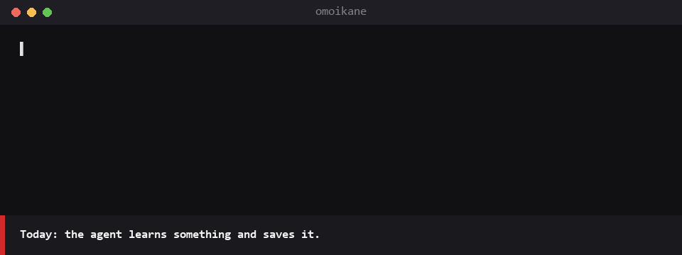

<p align="center"></p>

# Omoikane

*Eternal memory, alive and lightning fast.*

**Local memory for AI coding agents. One binary, one SQLite file, and the agent doesn't have to remember to look things up.**

<p align="center"></p>

[Español](README.es.md)

> Omoikane (思兼, "the one who gathers thoughts") is the kami the other gods consult when a decision has to be made: he remembers everything that is known and puts it together. That is what this program does for an agent.

## What makes it different

Your agent learns things every session: a bug that only shows up on Windows, why the team chose ULIDs, that you want short commits in English. Then the session ends and all of it is gone. Omoikane keeps those as short, typed memories in a local SQLite file, and does the rest by itself.

- **It recalls by itself, and almost always stays quiet.** When what you type relates to something saved, a hook hands the agent that memory in about 35 ms (with a large memory, the meaning model checks it on the few prompts where words found something, and the noise drops). If nothing relates, it hands over nothing, as with 93 % of real prompts. It also saves what the agent forgot to, when the session ends.
- **It understands what you ask, even with other words**, in 101 languages, accents or not. On the [public benchmark](https://github.com/marcmayol/omoikane-bench) (250 questions written blind), the right memory comes first for 89 % of questions and 55 % of paraphrases; engram 3.6, 71 % and 6 %.
- **Nothing gets lost.** No duplicates, history with reasons, stale memories flagged, secrets redacted, a trash everything comes back from and a copy of the database every day.
- **From you alone to a whole company.** The same memory on all your computers and with teammates, through a git repository of yours, encrypted. Spaces keep each client's memories apart, and trades share what one stack teaches (Android, web, WordPress…) with every project of that stack.
- **15 agents, one memory.** Claude Code, Codex, Gemini CLI, Cursor, Copilot, OpenCode and the rest; `omoi setup <agent>` gets each one ready. Two are tested by hand, the rest going by their documentation.
- **One binary, no server.** 9 MCP tools, SQLite built in, no Python, Node or Docker. It works offline, and on Windows just like on Linux and macOS.

## Install

In Claude Code (2.1.310 or newer), two commands and nothing else:

```text
/plugin marketplace add marcmayol/drac-plugins
/plugin install omoikane@drac
```

Automatic updates come off. `omoi setup claude` and the one-line installers ask whether you want them (no answer leaves them off) and, if you say yes, turn on the plugin's update too; `omoi upgrade --on` turns them on any time. For the plugin's, if you only ran the two commands above: `/plugin` → **Marketplaces** → **drac** → **Enable auto-update** (Claude Code leaves it off for third-party marketplaces).

On the first session the plugin downloads the `omoi` binary for your system from this repo's Releases (checking its SHA-256) into `~/.omoikane/bin`, then, in the background and once, the light embedding model (~150 MB); until it arrives, search works by words. The meaning model (EmbeddingGemma, ~450 MB) only comes when the memory passes 1,000 memories: Omoikane downloads it by itself then and says so. `omoi model semantic --on` brings it earlier, `--off` never. When the plugin updates, it fetches the matching binary. Prebuilt binaries: Windows x64, Linux x64/ARM64 (glibc 2.35 or newer), macOS Apple Silicon and Intel; anywhere else, `cargo install omoikane` and the plugin uses the `omoi` on your PATH (or set `OMOIKANE_BIN`). If you'd rather not run a binary you didn't build, do the same: `cargo install omoikane` builds it from the source published on crates.io.

**Without Claude Code**, or to use `omoi` from the terminal or another MCP client, install the binary with one line:

**Windows** (PowerShell)
```powershell
irm https://raw.githubusercontent.com/marcmayol/omoikane/master/install.ps1 | iex
```

**Linux and macOS**
```sh
curl -fsSL https://raw.githubusercontent.com/marcmayol/omoikane/master/install.sh | sh
```

Or `cargo install omoikane`. The installers also add the Claude Code plugin if Claude Code is there (`OMOIKANE_NO_SETUP=1` to skip it, `OMOIKANE_NO_MODEL=1` to skip the model).

## Stable since 1.0

Throughout 1.x, the database, the sync line and the `omoi export` format don't change in any way that breaks things: a 1.3 and a 1.0 sync with each other, and a computer on 1.0 keeps and passes on what it doesn't understand from a newer version. The MCP tools and their parameters don't break either; things only get added. If something ever has to break, that will be 2.0, with a migration and a warning.

Version 1.9.0, on crates.io and in the Releases, with CI on Windows, Linux and macOS. Used every day on Windows and Linux. How it works is in [docs/](docs/), what changes in each version in the [CHANGELOG](CHANGELOG.md), and where it's going in the [ROADMAP](ROADMAP.md).

## Measured

With 137 real notes and questions written blind by another agent, never used for tuning:

| | |
|---|---|
| right memory first / within the top three | 90 % / 97 % |
| search, median | 43 ms (50 ms at 3,183 memories, just as accurate) |
| real prompts that get something injected | 7 % of 300 |
| recall hook | 15-26 ms |
| embedding model ([potion-multilingual-128M](https://huggingface.co/minishlab/potion-multilingual-128M), int8) | opens in 2.7 ms; 13 MB per process |

Full method and every number: [BENCHMARK.md](BENCHMARK.md). The public, reproducible benchmark (3,000 notes from open projects, 250 questions written blind) lives in [omoikane-bench](https://github.com/marcmayol/omoikane-bench).

## Documentation

- [Recall and search](docs/recall.md): when it speaks and when it keeps quiet, stale memories, search in 101 languages, and how it compares with CLAUDE.md.
- [What a memory is and how it gets saved](docs/saving.md): kinds, duplicates, `/omoikane`, saving at session end, secrets, procedures and links.
- [Keeping it right and never losing it](docs/memory-care.md): stale detection, verdicts, merging, review dates, history, trash, export, Obsidian both ways, OKF bundles, daily copy, importing from engram.
- [Sync, projects and spaces](docs/sync-and-spaces.md): sharing between computers and teammates, encryption, one space per client, trades.
- [Agents](docs/agents.md): the Claude Code plugin, `omoi setup` and what works in each of the 15 agents.
- [Agents with nobody at the keyboard](docs/unattended.md): CI, servers and containers, configured by environment variables, with a GitHub Actions example.
- [Terminal, web view, HTTP and updates](docs/reference.md): the CLI, the TUI and the web view, the HTTP API, automatic updates and environment variables.

## Stack

Rust · [rusqlite](https://crates.io/crates/rusqlite) (bundled SQLite + FTS5) · [sqlite-vec](https://github.com/asg017/sqlite-vec) · [model2vec-rs](https://github.com/MinishLab/model2vec-rs) · [rmcp](https://github.com/modelcontextprotocol/rust-sdk)

## Contributing

Issues and pull requests are welcome: read [CONTRIBUTING.md](CONTRIBUTING.md) first (the rules that keep 1.x stable, and how to test). Security problems go through private reporting: [SECURITY.md](SECURITY.md).

## License

MIT · Marc Mayol
